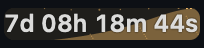
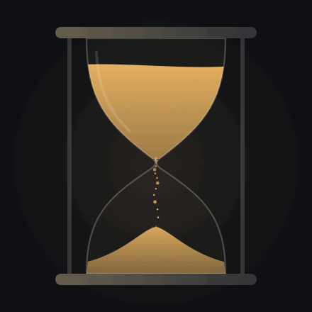
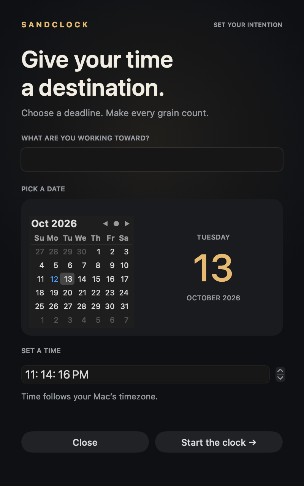

# Sandclock

A native Mac menu bar countdown with sand moving behind the digits, an animated hourglass, and a calendar for choosing your deadline. Built with Swift and AppKit, with no third-party dependencies or accounts.

| Menu bar countdown | Hourglass |
| :---: | :---: |
|  |  |

## Download

Get **Sandclock-macOS-arm64.zip** from the [latest release](https://github.com/rakeshvytla9/sandclock-macos/releases/latest).

1. Unzip the download and move **Sandclock.app** to Applications.
2. Open it. On first launch, choose a date from the calendar and set the time. Your Mac's timezone is used automatically. The name is optional and starts empty.
3. Click **Start the clock**. The countdown lives in the menu bar, with days, hours, minutes, and seconds.
4. Click the countdown to open the hourglass or edit the deadline. Right-click it for a compact edit/quit menu.

The release targets **Apple silicon Macs (M1, M2, and later) with macOS 13 or later**. It is ad-hoc signed and is **not Apple-notarized**. No paid Apple developer account is needed to build or run it locally.

The app has no Dock icon. It does not start automatically after reboot; add it in **System Settings → General → Login Items** if you want that.

### If macOS blocks opening Sandclock

After trying to open the app, go to **System Settings → Privacy & Security → Open Anyway** for Sandclock, then confirm **Open**. See [Apple's instructions](https://support.apple.com/en-us/102445).

If **Open Anyway** is missing and you downloaded the app from this repository's release page, move **Sandclock.app** to **Applications**, open **Terminal**, and paste:

```sh
codesign --verify --deep --strict "/Applications/Sandclock.app" &&
xattr -dr com.apple.quarantine "/Applications/Sandclock.app" &&
open "/Applications/Sandclock.app"
```

This checks the bundle's signature, removes the download quarantine flag for Sandclock only, and opens it. The signature check verifies the bundle's integrity; it does not mean Apple has approved the app. The app remains unnotarized. Each step runs only if the previous step succeeds.

If Terminal reports a signature error, download a fresh copy from the release page. If it says **No such file**, check that the unzipped app is named **Sandclock.app** and is in **Applications**. For other errors, include the exact Terminal output when [reporting the problem](https://github.com/rakeshvytla9/sandclock-macos/issues).

## Features

- Exact days, hours, minutes, and seconds in the menu bar.
- Grains enter from the left and settle to the right behind the digits. The text stays on top with a contrasting halo, and the graphic uses the countdown's existing width.
- Both the menu bar and the hourglass use the same small-column sand model. Neighbouring columns exchange sand when their visual slope is too steep. The hourglass's column capacities follow the curved glass walls. The falling stream keeps its gentle wavy motion, with a small outward splash where grains land.
- The visible flow stays near four grains per second. Each grain contributes a smaller fraction of the container on longer countdowns, so the fill reflects the countdown's elapsed percentage and finishes at the deadline.
- Calendar date picker and separate time control with seconds. The app uses the Mac's current timezone automatically, with no timezone selector. Once saved, the target is an absolute instant: changing timezone changes its displayed local time rather than the countdown's remaining duration.
- The name field starts empty, stays empty if saved without a name, and has no default motivational text.
- Gold above 25% remaining, amber above 10% through 25%, and red for the final 10%. At completion the colour returns to gold and the message is **“Hope you made it.”**
- Deadlines and names are saved locally between launches. The timer catches up from the actual target date after sleep; it stays at zero after completion.
- The menu bar refreshes once per second, matching the clock; the hourglass animates at 12 fps only while its popup is open. **Reduce Motion** is respected at launch. Digits are cached, and the menu bar uses pre-rendered images rather than a continuously animated custom view.
- No network calls, telemetry, microphone/camera access, or notifications. There is no completion alarm sound.



## Build

Install Apple's Xcode Command Line Tools, then run:

```sh
git clone https://github.com/rakeshvytla9/sandclock-macos.git
cd sandclock-macos
./scripts/build.sh
open dist/Sandclock.app
```

The script builds for the current Mac's architecture, ad-hoc signs the app, runs its checks, and creates a ZIP in `dist/`. To select an architecture explicitly:

```sh
./scripts/build.sh arm64
./scripts/build.sh x86_64
```

The published binary and UI were tested on Apple silicon. An Intel build path is provided, but Intel runtime behaviour has not been verified. Cross-compiled checks are skipped until run on matching hardware.

## Checks

```sh
dist/Sandclock.app/Contents/MacOS/Sandclock --self-test
```

Checks cover time-unit boundaries, fractional seconds, expired deadlines, progress, deadline-scaled grain arrivals, volume conservation, sideways spreading, rectangular and curved container bounds, percentage colour boundaries, the completion message, calendar/time merging, and nonexistent daylight-saving times. They do not open the UI or change a saved deadline.

Native preview exports use a sample countdown without changing local settings:

```sh
dist/Sandclock.app/Contents/MacOS/Sandclock --render-setup dist/calendar.png
dist/Sandclock.app/Contents/MacOS/Sandclock --render-preview dist/hourglass.png
dist/Sandclock.app/Contents/MacOS/Sandclock --render-complete dist/complete.png
dist/Sandclock.app/Contents/MacOS/Sandclock --render-menubar dist/menu-bar.gif
dist/Sandclock.app/Contents/MacOS/Sandclock --render-hourglass dist/hourglass.gif
```

## How the sand works

The visible grains follow simple horizontal travel and downward acceleration, with a small sine-wave offset for visual motion. A few decorative grains make short gravity-shaped arcs at impact, rising about two points before falling back onto the pile. The accumulated pile is a height field: incoming volume is deposited into columns, and excessive slopes transfer volume to neighbours. This is a stylized approximation, with slopes chosen for a small display; it does not simulate every grain's collisions, friction, or pressure. Splash grains decorate the impact without adding extra volume.

Long countdowns scale down the volume represented by each visible grain. Only a small number of airborne and recently landed grains are drawn. Large elapsed-time jumps are reconstructed in bounded batches rather than replaying months of arrivals. Editing a deadline starts a new interval for the sand and progress display.

In a short 10-second measurement on one Apple silicon Mac running macOS 27.2, the revised menu-bar-only renderer used about 3.1% of one CPU core. The earlier continuous renderer had been observed near 31%. This is a local measurement with the popup closed, not a battery benchmark or a guarantee for other machines. Compatibility across every macOS release and long-duration sleep/wake behaviour have not been exhaustively tested.

The app's local preferences use `local.sandclock.countdown`. Saved countdown settings are not included in this repository or the release ZIP.
